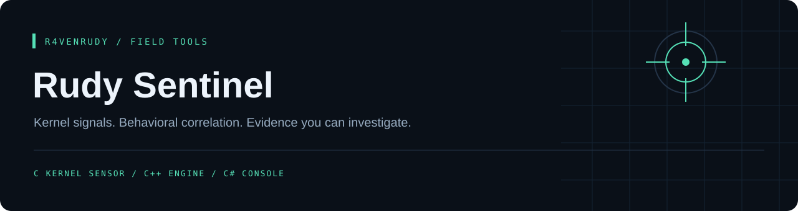
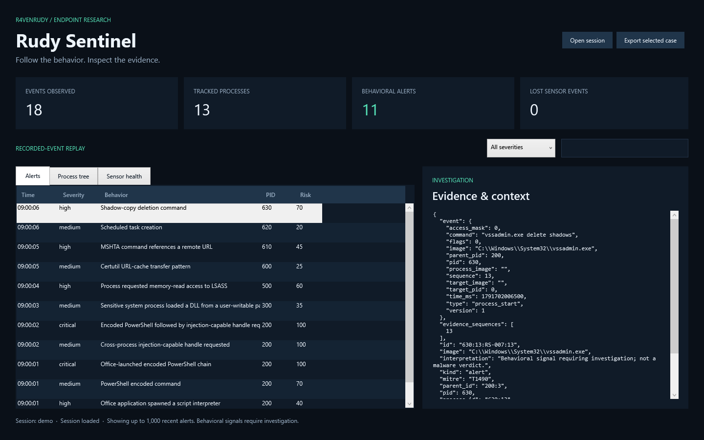

<p align="center"></p>

<p align="center">
<a href="https://github.com/r4venrudy/rudy-sentinel/actions/workflows/build.yml"></a>


<a href="LICENSE"></a>
</p>

<p align="center"><strong>Follow the behavior. Inspect the evidence.</strong></p>
<p align="center"><a href="#overview">Overview</a> · <a href="#capabilities">Capabilities</a> · <a href="#quick-start">Quick start</a> · <a href="docs/architecture.md">Architecture</a> · <a href="docs/lab-guide.md">Kernel lab</a></p>

---

## Overview

Rudy Sentinel is a Windows endpoint detection research project with an actual C kernel driver, a C++20 event collector and behavioral correlation engine, and a C#/.NET 10 WPF investigation console.

The sensor uses documented Windows callbacks to observe process creation and exit, user-mode image loads, and selected cross-process handle requests. The engine tracks process generations, evaluates declarative detection rules, correlates signals over time, and writes local evidence. The desktop console displays alerts, process trees, sensor health, and exportable cases.

**This is an observational research preview.** It does not provide a malware verdict, block execution, quarantine files, protect itself from administrators, or replace a production EDR. Compilation and replay tests do not establish kernel runtime safety. Driver loading, Driver Verifier, signing, stress tests, and performance qualification belong in an isolated Windows VM. See [validation status](docs/validation.md).

## Capabilities

| Component | Implementation | What it does |
|---|---|---|
| Kernel sensor | C / WDM | Process lifecycle, image-load notifications, sensitive process handle create/duplicate request audit |
| Detection agent | C++20 | Windows service, 14 declarative rules, two-stage correlation, risk scoring, replay |
| Investigation console | C# / WPF | Severity/text filters, process tree, raw evidence, health, local JSON case export |

- **Behavioral signals:** Office-launched interpreters, encoded PowerShell, remote MSHTA, Rundll32 script patterns, Certutil transfers, scheduled tasks, shadow-copy deletion, LSASS read-access requests, injection-capable handles, and DLL loads from selected user-writable paths.
- **Correlation:** Ordered stages within a configurable time window, evidence sequence references, per-process deduplication, and bounded risk scores.
- **Process identity:** PID plus event sequence distinguishes reused PIDs; parent identities refer to observed process generations.
- **Loss visibility:** The bounded kernel queue reports overflow/allocation failures; the agent writes health notices.
- **Restricted kernel interface:** Administrator/SYSTEM-only device, exclusive consumer, buffered/versioned read-only IOCTLs, no arbitrary memory access or process-control operations.
- **Reproducible investigation:** Synthetic fixtures, local NDJSON evidence, atomic state snapshots, bounded log rotation, and driver-free replay.



## Quick start

### Replay without a driver

Requirements: CMake 3.24+, a C++20 compiler, and .NET 10 SDK for the console. Windows is required for the desktop app; portable C/C++ tests and replay also build on Linux. CMake fetches a hash-pinned nlohmann/json 3.12.0 archive on the first build.

```powershell
git clone https://github.com/r4venrudy/rudy-sentinel.git
cd rudy-sentinel
cmake -S . -B build/native -A x64
cmake --build build/native --config Release --parallel
ctest --test-dir build/native -C Release --output-on-failure
build/native/Release/rudy-sentinel.exe --replay examples/demo.ndjson --rules rules/default.json --out run/demo
dotnet run --project console/RudySentinel.Console.csproj -c Release -- --data run/demo
```

Choose a fresh output directory for each foreground/replay run. The fixture is data only: its command lines are never executed. Replay is explicitly labeled in the console.

Linux:

```sh
cmake -S . -B build -DCMAKE_BUILD_TYPE=Release
cmake --build build --parallel
ctest --test-dir build --output-on-failure
./build/rudy-sentinel --replay examples/demo.ndjson --rules rules/default.json --out run/demo
```

### Shared evidence SDK (optional, offline)

Install [Rudy Evidence](https://github.com/r4venrudy/rudy-evidence), then configure Sentinel with `-DRS_EVIDENCE=ON -DCMAKE_PREFIX_PATH=/absolute/sdk/install`. CMake links its C++20 core directly. Export an existing alert log without loading a driver or collecting new events:

```sh
./build/rudy-sentinel --export-evidence run/demo/alerts.ndjson --scope host:lab-01:boot-01:session-01 > sentinel.evidence.json
```

Use a unique host/boot/session scope to keep process-generation IDs from separate captures distinct. Export includes alert sequence, image, MITRE ID and the investigation disclaimer; raw commands/events and health records are omitted. Recognized secret fields/patterns are redacted by the SDK. The bundle digest checks consistency, not authenticity. Normal builds keep this integration disabled; enabling it adds an installed SDK dependency and a driver-free replay/export test.

### Build the kernel sensor

Use Visual Studio 2022 with the C++ workload, MSBuild, and NuGet. This project pins the VS 2022-compatible SDK/WDK 10.0.26100.6584 packages.

```powershell
nuget restore packages.config -PackagesDirectory packages -NonInteractive
msbuild sensor/RudySensor.vcxproj /p:Configuration=Release /p:Platform=x64 /m
```

Output: `artifacts/sensor/Release/RudySensor.sys`, **unsigned**. Building never loads it. Read the [kernel lab guide](docs/lab-guide.md) before signing or running a driver. Production distribution requires supported signing and broader validation.

### Live collection in a configured test VM

After the appropriately signed lab driver has been installed and started:

```powershell
build/native/Release/rudy-sentinel.exe --live --rules rules/default.json --out run/live-01
```

The optional [installation script](scripts/Install-Lab.ps1) registers demand-start driver/agent services in a configured VM. Normal SCM stop/shutdown remains available; each service start creates a new session folder. The console reads a chosen session without communicating with the kernel.

## Detection rules

The default ruleset:

| ID | Signal | Severity | MITRE ATT&CK |
| :--- | :--- | :--- | :--- |
| RS-001 | Office application spawned a script interpreter | high | T1204.002 |
| RS-002 | PowerShell encoded command | medium | T1059.001 |
| RS-003 | MSHTA command references a remote URL | high | T1218.005 |
| RS-004 | Rundll32 script execution pattern | high | T1218.011 |
| RS-005 | Certutil URL-cache transfer pattern | medium | T1105 |
| RS-006 | Scheduled task creation | medium | T1053.005 |
| RS-007 | Shadow-copy deletion command | high | T1490 |
| RS-008 | Process requested memory-read access to LSASS | high | T1003.001 |
| RS-009 | Cross-process injection-capable handle requested | medium | T1055 |
| RS-010 | Sensitive system process loaded a DLL from a user-writable path | medium | T1574.002 |
| RS-011 | MSHTA runs inline script | high | T1218.005 |
| RS-012 | Regsvr32 scriptlet registration from a URL | high | T1218.010 |
| RS-C01 | Office-launched encoded PowerShell chain | critical | T1059.001 |
| RS-C02 | Encoded PowerShell followed by injection-capable handle request | critical | T1055 |

Edit [rules/default.json](rules/default.json), check it with `rudy-sentinel --check-rules --rules rules/default.json`, and start a new session. Conditions are ANDed; terms within `*_any`, names, or paths are ORed. `command_all` requires every substring. `switch_any` matches complete command-line tokens. Sequence rules reference two earlier rule IDs in order within `window_ms`; distinct rules may match the same event.

```json
{
  "id": "CUSTOM-001",
  "title": "Investigate a lab interpreter",
  "event": "process_start",
  "image_names": ["lab-interpreter.exe"],
  "severity": "medium",
  "score": 25,
  "mitre": "T1059"
}
```

These transparent heuristics have false positives and false negatives. Handle rights were **requested**, not necessarily granted. MITRE identifiers describe behavior categories. See [rule semantics and coverage limits](docs/architecture.md).

## Implementation notes

- Windows 10 2004+ x64 is the kernel API floor (`ExAllocatePool2`); Windows 11 x64 is the intended lab platform.
- Preexisting processes may be missing; best-effort user-mode path enrichment can race with process exit and PID reuse.
- Paths and commands have fixed limits; truncation flags are retained. Command lines and exports may contain sensitive data.
- The sensor has no file-system minifilter, registry/network monitor, content scanner, or ML classifier.
- The queue holds 1,024 events. No throughput or latency guarantee has been established. Per-event logging needs profiling before high-volume use.
- Unload removes callbacks before freeing storage. Load fails if any required callback registration fails, including signing/altitude failures.
- The object-callback altitude is a research placeholder; production use needs an assigned altitude.

## Validation

```powershell
dotnet run --project tests/Console.Tests -c Release
ctest --test-dir build/native -C Release --output-on-failure
```

GitHub Actions builds all three components, runs queue/engine/investigation tests, replays synthetic events, and renders the actual WPF console. Linux checks portable code with address/undefined-behavior sanitizers. See the current run for results. An unsigned `.sys` is a research build artifact.

## GitHub package

The Linux container packages the **C++ offline replay engine** and default rules. The Windows kernel driver and C# desktop console remain in the [Windows research release](https://github.com/r4venrudy/rudy-sentinel/releases/tag/v0.1.0-preview).

```sh
docker run --rm ghcr.io/r4venrudy/rudy-sentinel:latest --help
docker run --rm --network none --tmpfs /data:rw,uid=10001,gid=10001 ghcr.io/r4venrudy/rudy-sentinel:latest --replay /opt/sentinel/examples/demo.ndjson --rules /opt/sentinel/rules/default.json --out /data/demo
```

The second example runs synthetic event replay without network access and stores temporary results in memory. To retain evidence, bind-mount a writable folder at `/data`; on Linux pass `--user "$(id -u):$(id -g)"` for a folder owned by your user.

Every package build runs the C/C++ tests and an offline replay before publication. Images run as a non-root user and have `latest` and `sha-<full commit SHA>` tags. Live Windows monitoring is unavailable inside this Linux image.


## License

[MIT](LICENSE). The build-time nlohmann/json dependency is also MIT licensed. Original project code and visuals are included here.
