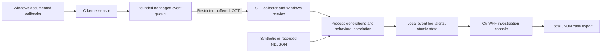

# Architecture

## Kernel lifetime

`DriverEntry` allocates queue storage and initializes synchronization before exposing the device. It registers process, image, and object callbacks. Failure unwinds registered callbacks and allocated resources. Unload unregisters callbacks before deleting the device and freeing storage.

Callbacks allocate a fixed-size event, copy bounded metadata, enqueue under a spin lock, and release the temporary record. They never scan files, contact networks, inspect arbitrary process memory, or evaluate detection rules. Each drain lock section copies one event; batches are capped at 64. Queue overflow and allocation failures are counted.

Selected cross-process user-mode handle requests are audited before completion without changing desired rights. A request does not establish that a handle operation, memory access, or injection succeeded.

## Wire protocol v1

See `shared/protocol.h`. x64 little-endian, 8-byte packing, fixed-width integers, bounded UTF-16:

| Structure | Bytes | Contract |
|---|---:|---|
| `RS_EVENT` | 1,592 | Size/version/type/flags, sequence, Windows epoch time, actor/parent/target PIDs, access, image, command |
| `RS_REQUEST` | 16 | Exact size/version, 1–64 maximum events, zero reserved |
| `RS_BATCH` | 48 | Size/version/count, produced/dropped/allocation counters, pending and capacity |

Two read-access `METHOD_BUFFERED` IOCTLs expose drain/statistics. Input length, version, reserved fields and output capacity are checked. The request is copied before reusing the system buffer. Only initialized header/event bytes are returned. No kernel pointers or image addresses cross the boundary.

`IoCreateDeviceSecure`, `FILE_DEVICE_SECURE_OPEN`, administrator/SYSTEM SDDL, exclusive opens and subpath rejection restrict access. The service never broadens that ACL. Administrators retain control; there is no administrator-resistant self-defense.

## Detection state

Sequences must strictly increase. Correlation expiry uses a nondecreasing time watermark because kernel wall-clock timestamps can arrive out of order. This may conservatively expire late events. A process identity combines PID and sequence; parent links refer to the generation observed at creation. At most 20,000 generations are retained, with eviction counts. Missing parents are not attached to a later reused PID.

Preexisting process paths can be enriched with `QueryFullProcessImageName`. Permission failures, exit races, PID reuse and truncation limit accuracy; enrichment is not a cryptographic identity or trust determination.

Rules are explicit conditions on events. Each rule fires once per process within the window. Two-stage correlations refer to earlier rules, require ordered evidence, and attach sequence references. Risk is the windowed sum of matching scores capped at 100, not a malware probability.

## Investigation

`events.ndjson` stores normalized input; `alerts.ndjson` stores behavioral/health notices; `state.json` is atomically replaced. Each log rotates at approximately 64 MiB into one previous file, bounding logs to about 256 MiB combined. Sequence references can outlive rotated evidence; archive sessions separately when complete retention is required.

The console reads a bounded tail of the current/previous alert logs and shows at most 1,000 recent notices. It counts malformed lines and identifies stale live sessions. Case exports include the selected alert with embedded triggering event and retained process history. Command lines and exports may be sensitive. Nothing is uploaded.

## Coverage

No prevention/remediation, file/registry/network sensor, reputation, script-content inspection, protected process, or driver self-defense is implemented. Standard administrative stop/remove controls remain available. Kernel runtime validation and performance profiling are separate gates.
